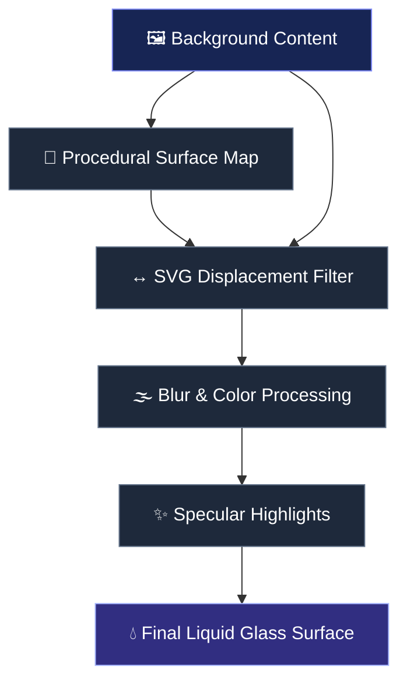

 <div align="center">

#  LiquidGlass Studio

### A new dimension of glass on the web.

**A browser-based optical playground for crafting, customizing, and exporting immersive liquid-glass interfaces.**

<p align="center">
  <a href="https://tylonmademe-1.github.io/liquid-glass-studio/">
    
  </a>
  <a href="https://github.com/tylonmademe-1/liquid-glass-studio">
    
  </a>
</p>

<p align="center">
  
</p>

<p align="center">
  
  
  
  
</p>

<p align="center">
  <a href="#-overview">Overview</a> ·
  <a href="#-features">Features</a> ·
  <a href="#-optical-engine">Optical Engine</a> ·
  <a href="#-quick-start">Quick Start</a> ·
  <a href="#-templates">Templates</a> ·
  <a href="#-code-export">Code Export</a> ·
  <a href="#-contributing">Contributing</a>
</p>

</div>

---

## ✨ Overview

**LiquidGlass Studio** is an interactive, browser-based studio for exploring realistic liquid-glass effects and building modern glassmorphism interfaces.

Traditional glassmorphism often relies on a translucent background and `backdrop-filter: blur()`. LiquidGlass Studio takes the concept further by combining SVG displacement, procedural surface maps, layered highlights, and carefully tuned lighting to create the appearance of curved, polished glass.

Instead of manually experimenting with CSS, you can explore a desktop-inspired environment, adjust optical parameters in real time, interact with floating glass elements, and generate reusable HTML/CSS.

**The goal:** make advanced glass effects easier to experiment with, customize, and integrate into real websites.

### What makes it different?

- **Optical distortion:** Displace the sampled image to simulate the curvature of a glass lens.
- **Procedural surfaces:** Generate normal-like maps for directional distortion.
- **Dynamic lighting:** Combine reflections, edge highlights, and inset shadows for a sense of depth.
- **Interactive workspace:** Experiment with draggable windows, themes, wallpapers, and controls.
- **Code generation:** Export a starting point for implementing your own liquid-glass interface.
- **No framework dependency:** Built around standard browser technologies.

> [!NOTE]
> The visual result depends on the browser's SVG filter and backdrop-filter support. Refraction-like distortion is a rendering technique, not a complete physical optics simulation.

---

## 🎨 Features

<table>
<tr>
<td width="50%" valign="top">

### 💧 Liquid Glass Lens

- Curved, translucent glass surfaces
- Adjustable distortion intensity
- Frosted and crystal-clear appearances
- Layered highlights and edge reflections
- Floating, draggable glass elements

</td>
<td width="50%" valign="top">

### 🎛️ Optical Control Panel

- Width and height adjustments
- Corner-radius customization
- Refraction and displacement scale
- Post-processing blur
- Brightness and saturation
- Immediate visual feedback

</td>
</tr>
<tr>
<td width="50%" valign="top">

### 🖥️ Desktop Experience

- macOS-inspired window controls
- Draggable application windows
- Minimize and maximize interactions
- Spotlight-style search
- Switchable desktop wallpapers

</td>
<td width="50%" valign="top">

### ⚡ Developer Workflow

- HTML/CSS code generation
- Copy-ready implementation snippets
- Reusable glass-effect configurations
- Dependency-free core implementation
- Simple local development workflow

</td>
</tr>
</table>

### Additional details

- **Liquid sliders:** Interactive capsule controls with glass-inspired visual feedback.
- **Curated templates:** Starting points for navigation bars, cards, and desktop docks.
- **Responsive presentation:** Designed to adapt the workspace to different viewport sizes.
- **Performance-conscious rendering:** Uses browser-native rendering features and avoids unnecessary layout work during interactions where possible.

---

## 🪄 The Experience

<div align="center">

| Design element | Purpose |
|:--|:--|
| 🔮 Optical lens | Creates the appearance of curved glass and image distortion |
| ✨ Specular highlights | Adds reflections and visual definition |
| 🌫️ Frosted surface | Softens background details while preserving color |
| 🌈 Color transmission | Retains and enhances colors passing through the glass |
| 🪟 Floating windows | Provides an interactive environment for experimentation |
| 🎚️ Live controls | Makes visual tuning direct and intuitive |

</div>

Want to experience the effect instead of just reading about it?

<div align="center">

### [Launch LiquidGlass Studio ↗](https://tylonmademe-1.github.io/liquid-glass-studio/)

*Open the studio, experiment with the optical settings, and explore the available templates.*

</div>

---

## 🔬 Optical Engine

LiquidGlass Studio combines several browser rendering techniques to approximate the visual properties of thick, curved glass.

### Rendering pipeline



### 1. Procedural surface mapping

A generated surface map describes how image pixels should be displaced across the glass.

A signed distance field (SDF) can describe the distance from a point to a lens boundary. Its gradients can then be used to estimate surface normals or displacement directions.

For a conventional RGB displacement map:

- **Red channel:** horizontal displacement input.
- **Green channel:** vertical displacement input.
- **Blue channel:** available for additional surface data or shader-specific purposes.

A neutral displacement value is typically around `128` in an 8-bit channel, where the displacement filter interprets that value as the midpoint.

### 2. SVG displacement

The SVG `<feDisplacementMap>` primitive uses a source image and a displacement map to distort image coordinates.

```html
<filter id="liquid-glass-filter">
  <feDisplacementMap
    in="SourceGraphic"
    in2="surface-map"
    scale="24"
    xChannelSelector="R"
    yChannelSelector="G"
  />
</filter>
```

This illustrates the displacement stage only. A complete implementation must also provide a valid `surface-map` input and integrate the filter with the actual rendering and backdrop-sampling setup.

### 3. Lighting and depth

The glass appearance can be enhanced by combining multiple layers:

```css
.liquid-glass {
  background: rgba(255, 255, 255, 0.08);
  border: 1px solid rgba(255, 255, 255, 0.28);

  box-shadow:
    0 4px 12px rgba(0, 0, 0, 0.18),
    inset 0 -10px 24px rgba(0, 0, 0, 0.10),
    inset 0 1px 4px rgba(255, 255, 255, 0.65);

  backdrop-filter: blur(8px) saturate(1.2);
  -webkit-backdrop-filter: blur(8px) saturate(1.2);
}
```

This CSS is a lightweight visual fallback, not a substitute for the studio's full refraction implementation.

> [!IMPORTANT]
> SVG filter behavior on backdrops varies across browser engines. Test the actual refraction effect in your target browsers rather than assuming that every browser supports the same filter pipeline.

---

## 🚀 Quick Start

### Prerequisites

- Git
- Node.js and npm for the included local server
- A modern browser such as Chrome, Edge, Safari, or Firefox

### 1. Clone the repository

```bash
git clone https://github.com/tylonmademe-1/liquid-glass-studio.git

cd liquid-glass-studio
```

### 2. Start the local server

```bash
npm start
```

Alternatively, run the server directly:

```bash
node server.mjs
```

If your local server uses port `3000`, open:

**http://localhost:3000**

> [!TIP]
> If you only want to inspect the static interface, you may be able to open `index.html` directly in a browser. Some functionality may require the local server, depending on how assets and browser APIs are used.

### 3. Explore the studio

1. Open the interactive workspace.
2. Select a template or glass element.
3. Adjust the optical parameters.
4. Experiment with window positioning and wallpapers.
5. Open the code-generation panel.
6. Copy the generated code and adapt it to your project.

---

## 🌐 Deployment

LiquidGlass Studio can be hosted as a static website using GitHub Pages, provided the deployed application does not require server-side functionality.

### GitHub Pages setup

1. Push the project to your GitHub repository.
2. Open **Settings → Pages**.
3. Select **GitHub Actions** as the deployment source.
4. Confirm that `.github/workflows/deploy.yml` exists and contains a valid deployment workflow.
5. Wait for the workflow to complete.
6. Open the deployed website.

Live demo:

**https://tylonmademe-1.github.io/liquid-glass-studio/**

If you fork the repository, update the demo URL and repository links to match your own GitHub username and repository name.

---

## 📦 Templates

Use the available templates as starting points for building your own interfaces.

<table>
<tr>
<th>Template</th>
<th>Description</th>
<th>Ideal use</th>
</tr>
<tr>
<td><strong>🍎 macOS Dock</strong></td>
<td>Floating glass bar with rounded application icons and hover magnification.</td>
<td>Desktop-inspired navigation</td>
</tr>
<tr>
<td><strong>🧭 Floating Navbar</strong></td>
<td>Rounded glass navigation with links, a search field, and subtle edge highlights.</td>
<td>Modern websites and dashboards</td>
</tr>
<tr>
<td><strong>🎴 Frosted Card</strong></td>
<td>Glass card with image content, typography, and a translucent toolbar.</td>
<td>Landing pages and product interfaces</td>
</tr>
</table>

---

## 🛠️ Code Export

The studio's code generator is intended to help you transfer your experiments into a real project.

### Suggested integration workflow

1. Configure your glass element in the studio.
2. Open the **Generate HTML/CSS** panel.
3. Copy the generated markup and styles.
4. Add any required SVG filter definitions.
5. Integrate the element into your existing layout.
6. Test it against different backgrounds and viewport sizes.

### Example: reusable glass component

```html
<svg
  aria-hidden="true"
  width="0"
  height="0"
  style="position: absolute; overflow: hidden"
>
  <defs>
    <filter
      id="liquid-glass"
      color-interpolation-filters="sRGB"
    >
      <feGaussianBlur
        in="SourceGraphic"
        stdDeviation="0.5"
        result="softened"
      />
      <feComponentTransfer in="softened">
        <feFuncA type="identity" />
      </feComponentTransfer>
    </filter>
  </defs>
</svg>

<div class="glass-panel">
  <h2>Liquid Glass</h2>
  <p>Build interfaces that play with light and depth.</p>
</div>
```

```css
.glass-panel {
  position: relative;
  overflow: hidden;
  isolation: isolate;

  padding: 2rem;
  border-radius: 28px;

  color: white;
  background: rgba(255, 255, 255, 0.10);
  border: 1px solid rgba(255, 255, 255, 0.25);

  box-shadow:
    0 12px 36px rgba(0, 0, 0, 0.18),
    inset 0 1px 1px rgba(255, 255, 255, 0.45);

  backdrop-filter: blur(14px) saturate(1.35);
  -webkit-backdrop-filter: blur(14px) saturate(1.35);

  transition:
    background 240ms ease,
    border-color 240ms ease,
    box-shadow 240ms ease,
    transform 240ms ease;
}

.glass-panel:hover {
  background: rgba(255, 255, 255, 0.14);
  border-color: rgba(255, 255, 255, 0.38);
  box-shadow:
    0 18px 48px rgba(0, 0, 0, 0.22),
    inset 0 1px 2px rgba(255, 255, 255, 0.55);
}

@media (prefers-reduced-motion: reduce) {
  .glass-panel {
    transition: none;
  }
}
```

**Important:** This is a standalone glassmorphism example. It demonstrates frosted glass and smooth hover transitions; it does not reproduce the studio's full dynamic refraction engine. Use the generator's actual output when you need the complete implementation.

---

## ⌨️ Keyboard Shortcuts

| Shortcut | Action |
|:--|:--|
| `⌘ K` / `Ctrl + K` | Open the Spotlight-style search, if enabled |
| `Esc` | Close the active modal or dialog, if supported |

---

## ⚡ Performance & Compatibility

The project is designed around native web technologies rather than a large rendering framework.

For smoother interactions:

- Update expensive effects only when their inputs change.
- Avoid rebuilding large surface maps unnecessarily.
- Use `requestAnimationFrame` for animation loops where appropriate.
- Limit expensive SVG filter regions to the area that needs processing.
- Avoid unnecessary layout reads and writes during pointer movement.
- Respect `prefers-reduced-motion`.
- Provide a conventional CSS fallback when advanced filtering is unsupported.

Actual frame rates depend on the browser, GPU, filter complexity, display resolution, and the number of active effects. A fixed frame rate cannot be guaranteed on every device.

---

## 🧰 Technology Stack

| Technology | Role |
|:--|:--|
| HTML5 | Structure and interface |
| CSS3 | Layout, lighting, transitions, and glass styling |
| Vanilla JavaScript | Interaction and controls |
| SVG filters | Image displacement and filter processing |
| Canvas, where used | Procedural surface-map generation |
| Node.js | Local development server |
| GitHub Actions | Automated deployment workflow |

**Dependencies:** The core interface is designed to run without a frontend framework. The local server and deployment workflow have their own runtime requirements.

---

## 🗺️ Project Roadmap

Potential improvements for future releases:

- [ ] Expand the template collection.
- [ ] Add more optical presets and one-click reset controls.
- [ ] Improve browser-specific refraction fallbacks.
- [ ] Add a dedicated mobile-friendly control layout.
- [ ] Introduce additional surface shapes and customizable lighting.
- [ ] Expand export options and implementation examples.
- [ ] Add performance diagnostics for complex effects.
- [ ] Improve keyboard accessibility and reduced-motion support.

These are roadmap ideas, not claims that the features are already implemented.

---

## 🤝 Contributing

Contributions, ideas, and bug reports are welcome.

### How to contribute

1. Fork the repository.
2. Create a feature branch.
3. Make a focused change.
4. Test the experience in a browser.
5. Open a pull request describing the change.

For bugs, include your browser, operating system, reproduction steps, and a screenshot or short recording when possible.

Please keep contributions consistent with the project's core goals: a lightweight implementation, a polished interface, and accessible developer tooling.

---

## 📄 License

LiquidGlass Studio is released under the **MIT License**.

See [`LICENSE`](LICENSE) for the complete license text.

You are free to use, modify, and distribute the project in accordance with the license terms.

---

<div align="center">

## 💎 Build something that bends light.

Experiment with surfaces. Refine the details. Create interfaces that feel tangible.

<p>
  <a href="https://tylonmademe-1.github.io/liquid-glass-studio/">
    
  </a>
</p>

**Created by [tylonmademe](https://github.com/tylonmademe-1)**

<sub>Designed for curious developers and people who love beautiful interfaces.</sub>

</div>
