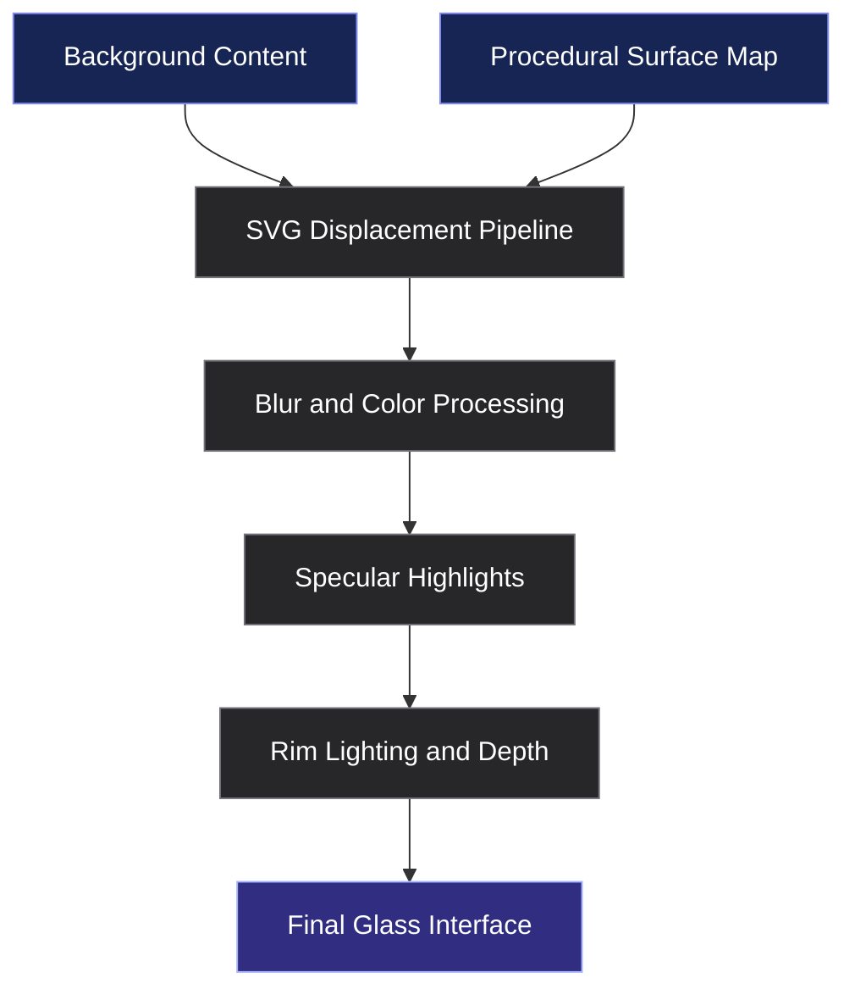

 <div align="center">

# LiquidGlass Studio

### Optical Refraction. Modern Interfaces. Complete Creative Control.

A browser-based studio for crafting liquid-glass interfaces with procedural surface maps, SVG displacement, dynamic lighting, and customizable optical effects.

<br/>

<a href="https://tylonmademe-1.github.io/liquid-glass-studio/">
  
</a>
<a href="https://github.com/tylonmademe-1/liquid-glass-studio">
  
</a>

<br/><br/>


<br/><br/>

**Designed for developers who want more than blur.**

</div>

---

## 01 — Project Overview

LiquidGlass Studio explores the intersection of modern interface design and browser-based optical effects.

Conventional glassmorphism typically uses transparency, background blur, and subtle borders. LiquidGlass Studio extends that visual language through displacement mapping, procedural surface geometry, layered specular highlights, and configurable lighting to approximate the appearance of polished, curved glass.

The result is an interactive design environment where developers can experiment with glass surfaces, control their optical characteristics, explore interface templates, and export implementation-ready starting points.

<table>
<tr>
<td width="50%" valign="top">

**Optical Rendering**

Create refraction-inspired distortion using SVG filters and procedural surface maps.

</td>
<td width="50%" valign="top">

**Interactive Design**

Adjust glass dimensions, curvature, blur, brightness, saturation, and distortion.

</td>
</tr>
<tr>
<td width="50%" valign="top">

**Desktop Workspace**

Explore floating windows, desktop-style interactions, wallpapers, and glass elements.

</td>
<td width="50%" valign="top">

**Developer Workflow**

Generate reusable HTML/CSS and adapt glass effects to your own projects.

</td>
</tr>
</table>

## 02 — Visual Showcase

<div align="center">

<!-- Replace these placeholders with screenshots committed to your repository. -->

<!--

-->

*Add a high-resolution screenshot of the actual studio here to showcase the workspace, optical controls, and glass rendering.*

</div>

The studio is designed around three complementary experiences:

- **Experiment:** Explore different glass shapes, lighting conditions, and distortion levels.
- **Customize:** Refine the visual properties of individual elements using interactive controls.
- **Export:** Take your experiments into real web projects using generated HTML and CSS.

<div align="center">

[**Open the Live Studio →**](https://tylonmademe-1.github.io/liquid-glass-studio/)

</div>

---

## 03 — Core Capabilities

### Optical Effects Engine

| Capability | Description |
|---|---|
| Surface distortion | SVG displacement-based image deformation |
| Procedural mapping | Surface-map generation for directional displacement |
| Refraction controls | Adjustable distortion scale and surface geometry |
| Frosted glass | Configurable blur and translucent backgrounds |
| Specular lighting | Layered highlights, rim lighting, and inset shadows |
| Color transmission | Brightness and saturation adjustments |

### Interactive Workspace

- **Floating glass lens:** Move and resize glass elements to experiment with their appearance.
- **Desktop environment:** Work with draggable windows and desktop-inspired controls.
- **Dynamic wallpapers:** Switch between visual backgrounds to evaluate the glass effect.
- **Interactive sliders:** Adjust optical parameters through custom capsule-style controls.
- **Window management:** Access supported minimize, maximize, and search interactions.
- **Keyboard navigation:** Use available shortcuts to access workspace functionality.

### Developer Experience

- HTML/CSS code generation.
- Reusable interface templates.
- Framework-independent implementation.
- Lightweight browser-native technologies.
- Local development and static deployment workflows.

> Feature availability depends on the implementation in the repository. Rendering behavior and advanced filtering support can vary between browsers.

---

## 04 — Optical Engine Architecture

LiquidGlass Studio combines procedural geometry, SVG filter primitives, and layered styling to approximate the behavior of light passing through a curved glass surface.



### Surface-map generation

A procedural surface map can encode the direction and magnitude of image displacement. Signed distance fields (SDFs) describe the distance to a surface boundary and can be used to derive gradients that approximate surface normals.

For an 8-bit RGB displacement map:

- **Red:** horizontal displacement input.
- **Green:** vertical displacement input.
- **Neutral midpoint:** approximately `128` for an 8-bit channel.
- **Displacement scale:** controls the strength of the resulting deformation.

### SVG displacement

The SVG `<feDisplacementMap>` primitive uses channel values from a displacement map to offset source-image coordinates.

```html
<filter id="liquid-glass-filter">
  <feDisplacementMap
    in="SourceGraphic"
    in2="surface-map"
    scale="24"
    xChannelSelector="R"
    yChannelSelector="G"
  />
</filter>
```

This is an illustrative fragment, not a complete standalone refraction implementation. A functioning pipeline must provide the referenced map and integrate it with the appropriate source image and rendering context.

### Lighting and surface depth

Layered styling helps establish the appearance of a polished glass object:

```css
.liquid-glass {
  background: rgba(255, 255, 255, 0.08);
  border: 1px solid rgba(255, 255, 255, 0.28);

  box-shadow:
    0 8px 24px rgba(0, 0, 0, 0.18),
    inset 0 -8px 24px rgba(0, 0, 0, 0.10),
    inset 0 1px 3px rgba(255, 255, 255, 0.65);

  backdrop-filter: blur(10px) saturate(1.25);
  -webkit-backdrop-filter: blur(10px) saturate(1.25);
}
```

These styles demonstrate the lighting layer. They provide a visual fallback rather than reproducing the complete displacement-based effect.

**Rendering note:** Browser support for SVG filters, backdrop filtering, and their combination varies. The visual result depends on the rendering engine, GPU, filter configuration, and underlying content.

---

## 05 — Getting Started

### Requirements

- Git
- Node.js and npm for the included local server
- A modern web browser

### Clone the repository

```bash
git clone https://github.com/tylonmademe-1/liquid-glass-studio.git

cd liquid-glass-studio
```

### Start the local server

```bash
npm start
```

Alternatively:

```bash
node server.mjs
```

If the server uses port `3000`, visit:

`http://localhost:3000`

For static inspection, you may also open `index.html` directly in a browser. Features that depend on server behavior may not work in that mode.

### First-time workflow

1. Open the studio and select an available template.
2. Choose a glass element to customize.
3. Adjust dimensions, corner radius, distortion, and lighting.
4. Preview the result against different backgrounds.
5. Open the code-generation interface.
6. Export the markup and styles, then integrate them into your application.

---

## 06 — Curated Templates

The studio provides starting points for common glass-inspired interface patterns.

<table>
<tr>
<th>Template</th>
<th>Design characteristics</th>
<th>Use cases</th>
</tr>
<tr>
<td><strong>macOS Dock</strong></td>
<td>Translucent floating bar, rounded icons, hover magnification</td>
<td>Desktop-inspired interfaces</td>
</tr>
<tr>
<td><strong>Floating Navbar</strong></td>
<td>Rounded navigation, search field, subtle optical highlights</td>
<td>Websites and dashboards</td>
</tr>
<tr>
<td><strong>Frosted Card</strong></td>
<td>Translucent surface, image content, typography, toolbar</td>
<td>Landing pages and content panels</td>
</tr>
</table>

Use these templates as a foundation for experimenting with surface geometry, spacing, and lighting rather than as rigid design systems.

---

## 07 — Code Export & Integration

The code-generation interface is designed to help move visual experiments from the studio into a website or application.

### Recommended integration process

1. Configure the desired effect in the studio.
2. Adjust the relevant optical settings.
3. Generate and copy the HTML/CSS.
4. Include any required SVG definitions and supporting assets.
5. Adapt the component to your layout and design system.
6. Test the result in the browsers and viewports you support.

Generated snippets may require integration-specific adjustments. In particular, displacement filters and backdrop sampling should be tested in the actual target environment.

### Integration considerations

- Avoid duplicate SVG filter IDs when using multiple instances.
- Keep filter regions appropriately sized.
- Provide fallback styles for unsupported effects.
- Respect reduced-motion preferences.
- Check contrast and readability over complex backgrounds.

---

## 08 — Keyboard Shortcuts

| Shortcut | Action |
|---|---|
| `Ctrl + K` / `⌘ K` | Open Spotlight-style search, when supported |
| `Esc` | Close the active modal or dialog, when supported |

---

## 09 — Technology Stack

<table>
<tr>
<th>Technology</th>
<th>Responsibility</th>
</tr>
<tr>
<td>HTML5</td>
<td>Document structure and interface components</td>
</tr>
<tr>
<td>CSS3</td>
<td>Layout, visual styling, lighting, and transitions</td>
</tr>
<tr>
<td>Vanilla JavaScript</td>
<td>Application interactions and control logic</td>
</tr>
<tr>
<td>SVG Filters</td>
<td>Displacement and image-processing effects</td>
</tr>
<tr>
<td>Canvas, where used</td>
<td>Procedural surface-map generation</td>
</tr>
<tr>
<td>Node.js</td>
<td>Local development server</td>
</tr>
<tr>
<td>GitHub Actions</td>
<td>Automated deployment workflow</td>
</tr>
</table>

The core application is designed to operate without a frontend framework. The development server and deployment workflow may have separate requirements.

---

## 10 — Deployment

LiquidGlass Studio can be deployed through GitHub Pages if the application is compatible with static hosting.

1. Push the project to GitHub.
2. Open **Settings → Pages**.
3. Select **GitHub Actions** as the deployment source.
4. Verify the repository's `.github/workflows/deploy.yml`.
5. Confirm that the workflow completes successfully.
6. Open the published site.

**Live deployment:** [tylonmademe-1.github.io/liquid-glass-studio](https://tylonmademe-1.github.io/liquid-glass-studio/)

For forks, update the repository URLs and deployment configuration as necessary.

---

## 11 — Performance & Compatibility

Liquid-glass effects can be computationally expensive, especially when large filter regions are updated continuously.

Recommended practices:

- Use `requestAnimationFrame` for appropriate animation loops.
- Avoid unnecessary layout reads and writes during pointer movement.
- Reuse procedural maps when their inputs have not changed.
- Minimize expensive filter regions and redundant processing.
- Provide a conventional CSS fallback.
- Respect `prefers-reduced-motion`.

Performance varies by hardware, browser, viewport resolution, and the complexity of active effects. A specific frame rate cannot be guaranteed across devices.

---

## 12 — Roadmap

Potential areas for future development:

- [ ] Expand the collection of glass interface templates.
- [ ] Add more optical presets and configuration options.
- [ ] Improve cross-browser rendering fallbacks.
- [ ] Refine mobile workspace usability.
- [ ] Introduce additional surface geometries and lighting controls.
- [ ] Expand export options and implementation examples.
- [ ] Improve accessibility and reduced-motion support.
- [ ] Add tools for evaluating rendering performance.

*Roadmap items describe potential improvements and are not claims of existing functionality.*

---

## 13 — Contributing

Contributions, bug reports, and suggestions are welcome.

1. Fork the repository.
2. Create a dedicated branch for your changes.
3. Implement and test the proposed improvement.
4. Submit a pull request with a clear description.

For bug reports, include the browser, operating system, reproduction steps, and screenshots when relevant.

---

## 14 — License

This project is distributed under the **MIT License**. See [`LICENSE`](LICENSE) for the complete license terms.

---

<div align="center">

### LiquidGlass Studio

**A workspace for exploring light, depth, and modern interface design.**

[Live Demo](https://tylonmademe-1.github.io/liquid-glass-studio/) · [GitHub Repository](https://github.com/tylonmademe-1/liquid-glass-studio)

Created by [tylonmademe](https://github.com/tylonmademe-1)

</div>
